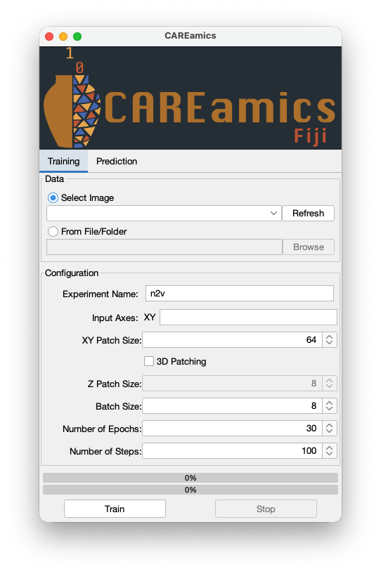
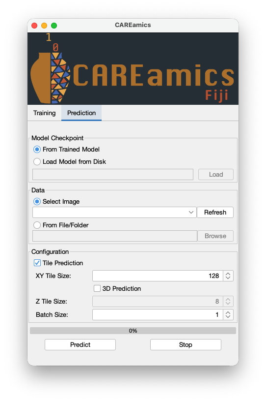

# CAREamics Fiji Plugin
------------------------

### How to install
You need to copy the plugin **`jar`** into your Fiji Plugin directory.
- Windows / Linux: Open your main Fiji.app folder, and you will see a folder named plugins right inside.
- macOS: Right-click (or Control-click) on the Fiji application icon, choose Show Package Contents, and navigate to Contents/Plugins/ or look inside the extracted Fiji.app folder depending on how you installed it.
- You can also install the plugin in Fiji using *Plugins > Install Plugin...* menu and point to the downloaded plugin `.jar` file.

Also, check [here](https://imagej.net/imagej-wiki-static/Installing_3rd_party_plugins) for alternative ways.

>[!TIP]
> You can find the saved checkpoint of the trained model in `<your home dir>/careamics_logs`.

### How to use
#### Training

 

#### prediction

